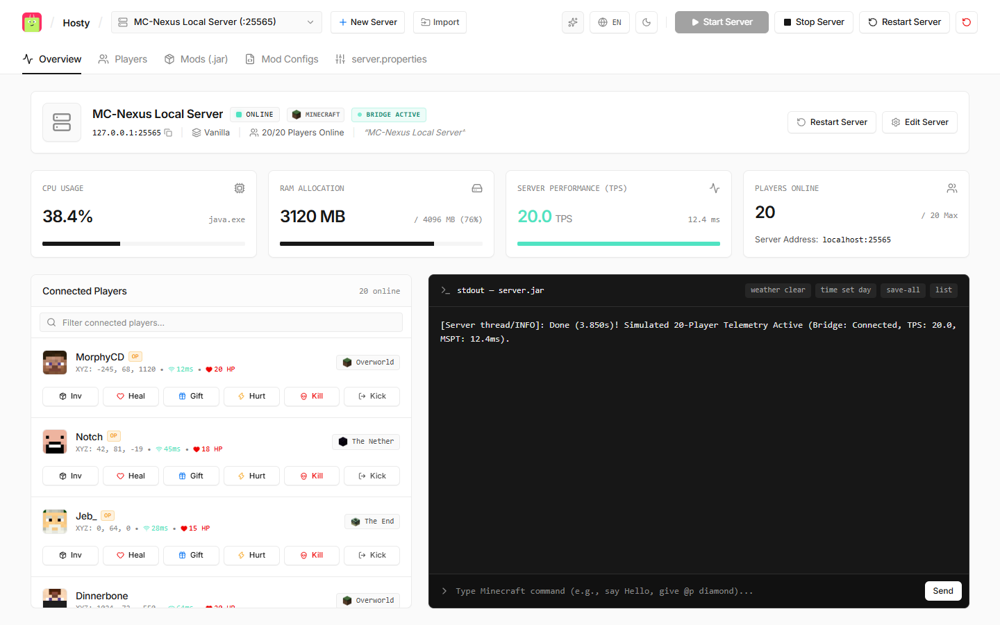
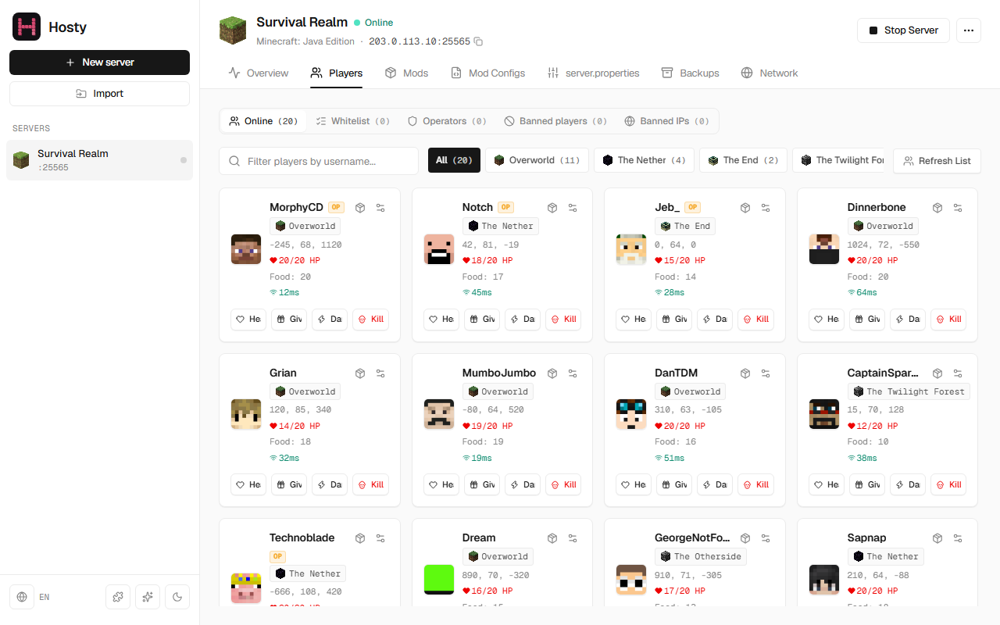
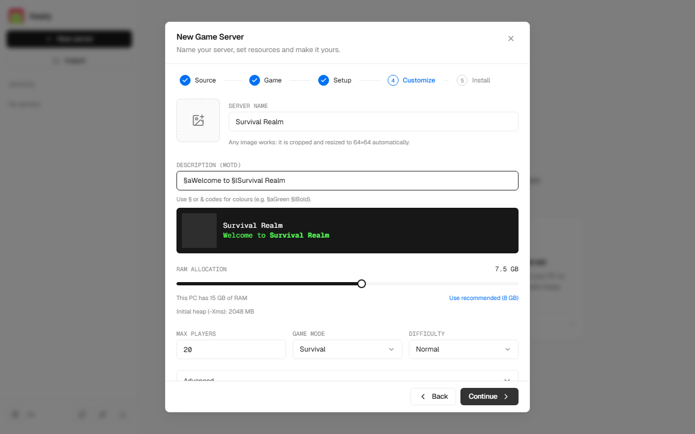

<div align="center">



**Your local game servers, one friendly dashboard.**

Create, run and manage dedicated servers on your own PC — no terminals, no config-file hunting, no headaches.


</div>

---



## What is Hosty?

Hosty is a desktop app that makes hosting a game server on your own computer as easy as playing the game. Pick a game, pick a version, press **Start** — Hosty handles the downloads, the setup and the monitoring for you.

It is **not tied to a single game**. Hosty is built as a multi-game platform, and support for more games is added over time.

## Supported games

| Game | Status |
| --- | --- |
| **Minecraft** (Vanilla, Paper, Purpur, Fabric, Forge, NeoForge) | Available |
| **Project Zomboid** | Beta (SteamCMD install) |
| **Hytale** | Coming soon |
| **Any game** | Add it yourself with a [game pack](docs/game-packs.md) |

## Highlights

- **Guided server creation** — a step-by-step wizard picks the game, installs the server for you (including Forge and NeoForge), detects the loader of a jar you bring and sets sensible defaults.
- **One-click control** — a single Start/Stop button per server, with restart and a confirmed force-close in the menu, and safe saving on shutdown.
- **Live dashboard** — watch CPU, memory, server performance and who is online, in real time.
- **Live console** — read the server output and send commands, with handy shortcuts.
- **Player management** — see where everyone is and heal, gift, hurt, kick or inspect inventories without typing commands.
- **Mods made easy** — enable, disable or remove mods, and edit their settings from the app.
- **Easy settings** — tweak server properties with a clean editor instead of raw text files.
- **Import existing servers** — pick a folder and Hosty detects the game, loader and version.
- **Multiple servers** — keep several servers in the sidebar and switch between them instantly.
- **Extensible** — add games with a small [game pack](docs/game-packs.md) and connect in-game bridges through an open [protocol](docs/bridge-protocol.md).
- **Light & dark themes**, available in **English** and **Spanish**.

<table>
  <tr>
    <td></td>
    <td></td>
  </tr>
  <tr>
    <td align="center"><sub>Manage players at a glance</sub></td>
    <td align="center"><sub>Create a server in a few steps</sub></td>
  </tr>
</table>

## Requirements

- Windows 10 / 11 (64-bit). macOS and Linux builds are produced by CI but are not validated yet.
- Java 17 or 21 (only for games that need it, such as Minecraft)

## Getting started

Download the latest installer from the [Releases](../../releases) page, run it and create your first server.

### Running from source

You will need Node.js 20+ (22 LTS recommended) and the stable Rust toolchain.

```bash
# Install dependencies
npm --prefix daemon install
npm --prefix client install

# Terminal 1: the daemon (the desktop app uses it in dev mode)
npm run dev:daemon

# Terminal 2: the full desktop app
npm run tauri:dev
```

## Project status

Hosty is in **alpha** (`0.3.x`) and evolving quickly. Feedback and ideas are very welcome. See [docs/releasing.md](docs/releasing.md) for platform status and code signing.

## License

Hosty is free to use, copy and modify for any noncommercial purpose under the
[PolyForm Noncommercial License 1.0.0](LICENSE). Selling it, or using it in a paid product or service, is not allowed,
and anyone who shares it or a modified version must keep the copyright notice (`Required Notice:` line in [LICENSE](LICENSE)).

The SDK packages in `packages/` (`game-sdk`, `create-hosty-game`, `bridge-protocol`) stay under MIT so anyone can build
game packs with them. Game packs by other authors keep the license their authors chose.
